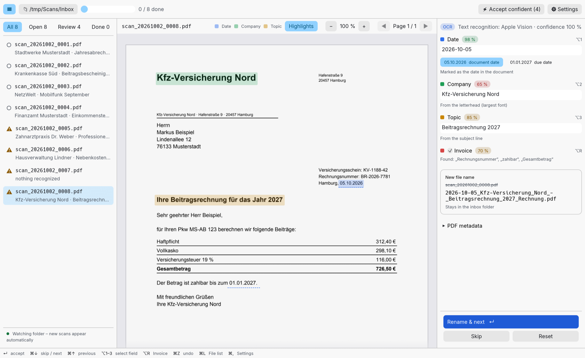
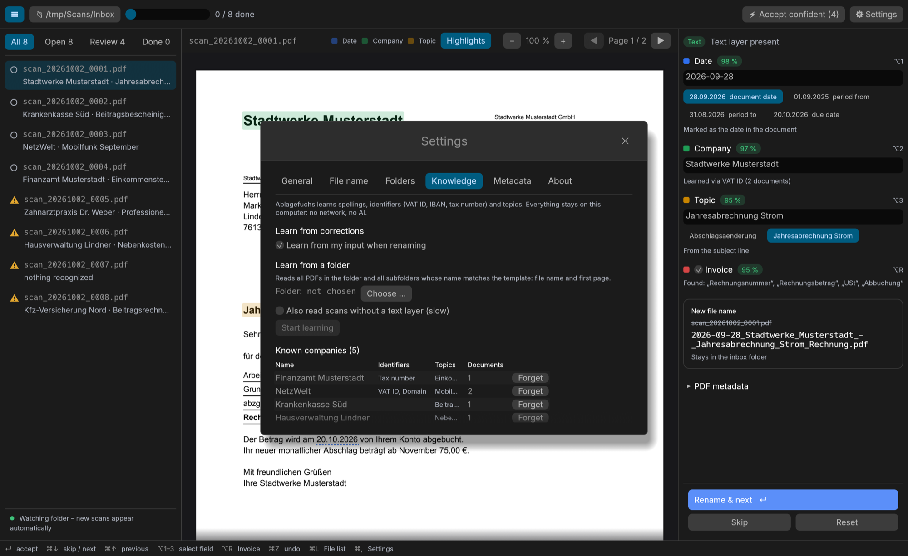

# Ablagefuchs

**Rename scanned documents in seconds.** Ablagefuchs shows your scanned PDFs one by one, recognizes
date, company and topic, and suggests a file name like

```
2026-09-28_Stadtwerke_Musterstadt_-_Jahresabrechnung_Strom_Rechnung.pdf
```

Press Enter to accept, or fix a field and go on. A desktop app for macOS, Windows and Linux,
written in Rust. Works completely offline: no server, no database, no cloud.



> **Status: early release (0.3).** Recognition rules have been developed on sample letters and tested on a
> real archive. Feedback with real-world (anonymized) scans is very welcome. See the [changelog](CHANGELOG.md).

## Features

- **Preview with highlighted findings.** Click another date in the document to use it, or select text
  and send it to the company or topic field.
- **Recognition of date, sender, topic and invoices**, with a confidence score and the source for every
  field ("from the letterhead", "learned via VAT ID" …).
- **Learns locally** from your existing archive and from your corrections: spellings, identifiers
  (VAT ID, IBAN, tax number, domain) and typical topics per company. Archive file names don't have to
  follow the template: the company is confirmed by the letter itself. Re-learning only reads new files.
- **Recognizes senders by their letterhead image**, also when the company name is printed only as a logo.
- **Manage what was learned:** search, rename and merge companies, with suggestions for likely duplicates.
  Files that could not be learned can be gone through one by one.
- **Export and import** settings and knowledge to use Ablagefuchs on several computers.
- **Configurable file name template** (`{datum}_{unternehmen}_-_{thema}{rechnung?:_Rechnung}`).
- **Batch mode** for files recognized with high confidence; **undo** for every rename.
- **Searchable scans:** writes PDF metadata (title, keywords), an invisible OCR text layer and
  Finder tags (macOS).
- **Duplicate detection** by content or text fingerprint.
- **Built-in OCR of each system:** Apple Vision (macOS), Windows OCR, Tesseract (Linux).
- Watches the inbox folder: new scans appear automatically.
- Fully usable with the keyboard; user interface in English and German, light and dark.



## Installation

Download the latest version from the [releases page](https://github.com/eckonator/ablagefuchs/releases).

**macOS** (Apple Silicon and Intel). The easiest way is to paste this into Terminal:

```sh
curl -fsSL https://raw.githubusercontent.com/eckonator/ablagefuchs/main/scripts/install-macos.sh | bash
```

It installs the newest release into `/Applications`. Alternatively open the `.dmg` and drag Ablagefuchs
to Applications. The app is not notarized by Apple, so macOS blocks the first launch from the `.dmg`:
open *System Settings → Privacy & Security* and click *Open Anyway*. The install command above
avoids this step.

**Windows** (64-bit): unpack the `.zip` and start `Ablagefuchs.exe`.

**Linux** (x86_64): unpack the `.tar.gz` and start `ablagefuchs`. For scans without a text layer
install Tesseract with German language data, e.g. `sudo apt install tesseract-ocr tesseract-ocr-deu`.

## Usage

1. Choose your inbox folder (where the scanner stores its PDFs).
2. Check the suggestion on the right. Adjust a field if needed: type, click a date in the preview,
   or select text in the document.
3. Press <kbd>Enter</kbd> to rename and go to the next file. <kbd>⌘Z</kbd> / <kbd>Ctrl+Z</kbd> undoes.

| Key (macOS) | Windows / Linux | Action |
|---|---|---|
| <kbd>Enter</kbd> | <kbd>Enter</kbd> | Rename and go to the next file |
| <kbd>⌘↓</kbd> / <kbd>⌘↑</kbd> | <kbd>Ctrl+↓</kbd> / <kbd>Ctrl+↑</kbd> | Next / previous file |
| <kbd>⌥1</kbd>–<kbd>⌥3</kbd> | <kbd>Alt+1</kbd>–<kbd>Alt+3</kbd> | Jump to date, company, topic |
| <kbd>⌥R</kbd> | <kbd>Alt+R</kbd> | Toggle "invoice" |
| <kbd>⌘Z</kbd> | <kbd>Ctrl+Z</kbd> | Undo the last rename |
| <kbd>⌘+</kbd> / <kbd>⌘−</kbd> / <kbd>⌘0</kbd> | <kbd>Ctrl++</kbd> / <kbd>Ctrl+−</kbd> / <kbd>Ctrl+0</kbd> | Zoom the preview |
| <kbd>⌘L</kbd> | <kbd>Ctrl+L</kbd> | Show / hide the file list |
| <kbd>⌘,</kbd> | <kbd>Ctrl+,</kbd> | Settings |

Every rename is logged in `.ablagefuchs/journal.jsonl` inside the inbox folder. Ablagefuchs never
overwrites a file; on a name collision it appends `_2`, `_3` ….

## Privacy

- Your documents never leave your computer. Recognition, OCR and learning run locally, without AI and
  without network access.
- What Ablagefuchs learns is stored in `wissen.json` (and which archive files it has read in
  `lernstand.json`) in its settings folder and can be viewed, edited and deleted under
  *Settings → Knowledge*. An export file contains the same data and stays wherever you save it.
- The only network request is an optional check for new versions on GitHub. Ablagefuchs asks before
  enabling it; it sends nothing about your documents or settings.
- No telemetry, no account.

## Building

You need a current Rust toolchain ([rustup.rs](https://rustup.rs)). On Linux you also need the
X11/Wayland development packages, e.g. on Debian/Ubuntu:

```sh
sudo apt install libxkbcommon-dev libwayland-dev libx11-dev libxcursor-dev libxrandr-dev libxi-dev libgl1-mesa-dev pkg-config
```

```sh
cargo xtask fetch-pdfium      # downloads the PDFium library into vendor/ (needed once)
cargo xtask demo-pdfs         # generates sample scans of fictional companies into demo/Eingang
cargo run -p ablagefuchs      # starts the app
cargo test --workspace        # runs the tests
```

## Architecture

| Part | Purpose |
|---|---|
| `crates/core` | Recognition, file name template, learned knowledge, journal. No PDF or GUI dependencies, fully tested. |
| `crates/pdf` | PDF access: rendering and text with positions via [PDFium](https://pdfium.googlesource.com/pdfium/), metadata via lopdf. |
| `crates/ocr` | Text recognition for scans without a text layer, using the OCR engine built into each system. |
| `cli` | `ablagefuchs-cli` for scripting and debugging. |
| `app` | The user interface (egui). |
| `xtask` | Developer tools (`cargo xtask …`). |

Code comments are in German; issues and contributions in English are welcome.

## License

Copyright © 2026 Markus Eckert

Licensed under either of

- Apache License, Version 2.0 ([LICENSE-APACHE](LICENSE-APACHE))
- MIT license ([LICENSE-MIT](LICENSE-MIT))

at your option.

Unless you explicitly state otherwise, any contribution intentionally submitted for inclusion in
the work by you, as defined in the Apache-2.0 license, shall be dual licensed as above, without any
additional terms or conditions.

Releases bundle [PDFium](https://pdfium.googlesource.com/pdfium/) (BSD-3-Clause / Apache-2.0,
binaries from [pdfium-binaries](https://github.com/bblanchon/pdfium-binaries)) and use the
[Inter](https://rsms.me/inter/) typeface (SIL Open Font License 1.1).
